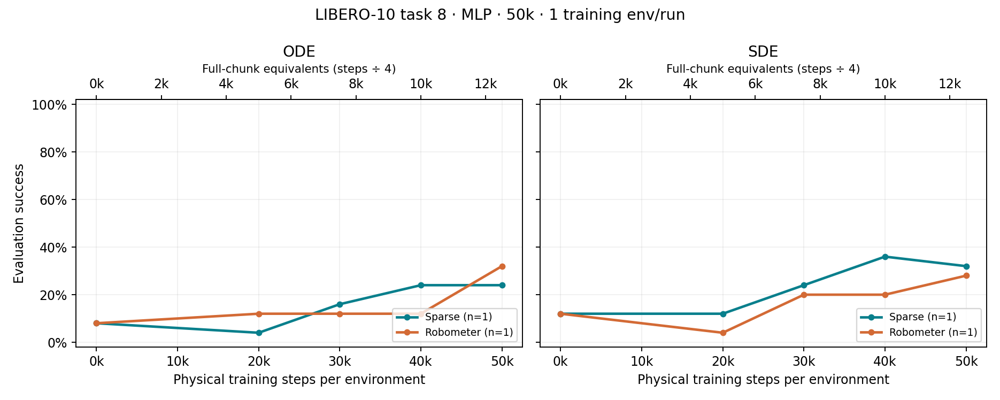
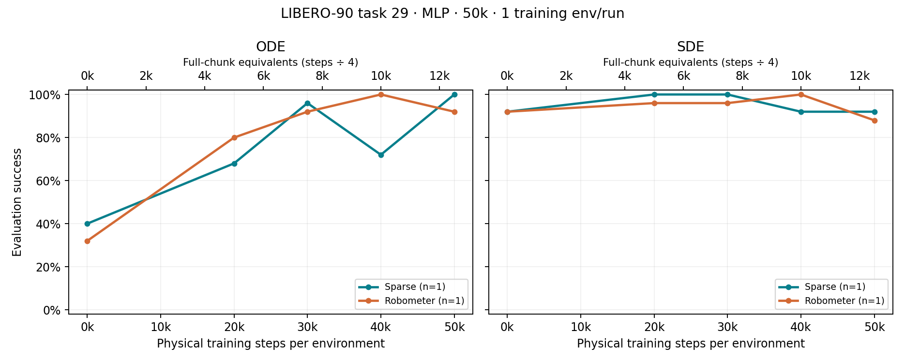
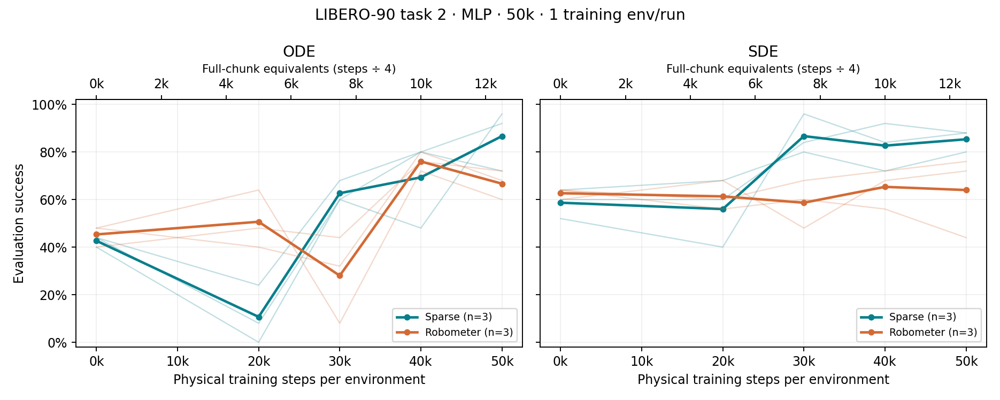
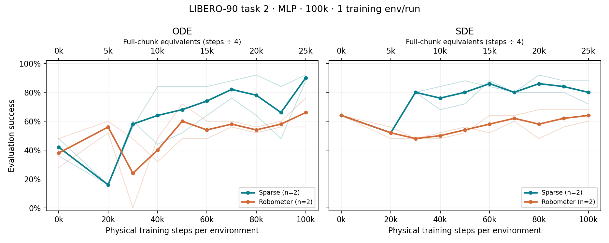
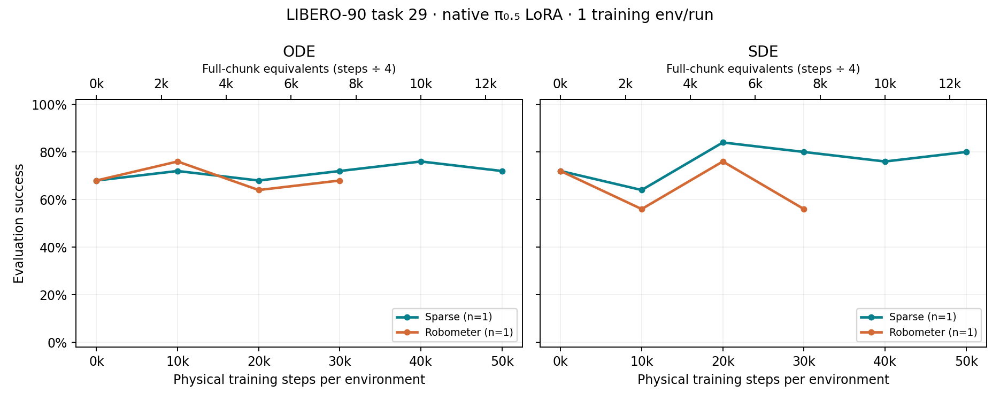

# OGPO success rates and training step counts

**Snapshot · 2026-10-31T18:55:01.548805+00:00** · Task IDs are zero-based.

Success is simulator task completion, including for Robometer-trained policies. ODE and SDE are separate evaluation samplers; MLP SDE uses best-of-8, while native LoRA uses a single sample. Each checkpoint uses 25 episodes per seed and sampler. Multiple seeds share a BC checkpoint.

[Numerical evidence](evidence.json) · [All evaluation points](evaluation_points.csv) · [DSRL and Robometer report](../reward_learning_summary_20261028/report.md)

## X axis and environment counts

| Runs | Training envs per run | Actions executed per chunk | X axis | Full-chunk equivalent |
|---|---:|---:|---|---|
| MLP OGPO, 50k budget | 1 | Up to 4 | 50,000 physical steps/env = 50,000 total | 12,500 |
| MLP OGPO, 100k budget | 1 | Up to 4 | 100,000 physical steps/env = 100,000 total | 25,000 |
| Native π₀.₅ LoRA, 50k budget | 1 | Up to 4 | 50,000 physical steps/env = 50,000 total | 12,500 |

**Full-chunk equivalents = physical steps ÷ 4**, not measured chunk counts. Early termination can shorten chunks, so the actual number of policy calls can be higher. The upper chart axis uses this equivalent. Seeds are independent runs, not parallel environments within one run. Evaluation rollouts and BC optimizer updates are excluded from the RL x axis. For historical MLP runs, the recorded BC offset is subtracted from the CSV step counter.

MLP replay records individual physical transitions; native LoRA replay records variable-duration chunks. Neither a replay-entry count nor an optimizer-update count is interchangeable with the physical-step axis. See [MLP collection](../../../OGPO/ogpo/runners/online_rl_runner.py) and [native LoRA collection](../../../OGPO/scripts/pi05_ogpo.py).

## Success comparisons

Solid curves show fixed-cohort means; faint curves show the individual seeds in that cohort. The 100k comparison uses only seeds with both reward arms completed. Native LoRA curves end at each run’s latest complete evaluation. No significance tests are implied.

### LIBERO-10 task 8 · MLP · 50k

| Reward | Seeds | Latest steps/env | ODE start → latest | SDE start → latest |
|---|---|---:|---:|---:|
| Sparse | 100 | 50,000 | 8.0% → **24.0%** | 12.0% → **32.0%** |
| Robometer | 100 | 50,000 | 8.0% → **32.0%** | 12.0% → **28.0%** |

Show LIBERO-10 task 8 · MLP · 50k success curves

### LIBERO-90 task 29 · MLP · 50k

| Reward | Seeds | Latest steps/env | ODE start → latest | SDE start → latest |
|---|---|---:|---:|---:|
| Sparse | 100 | 50,000 | 40.0% → **100.0%** | 92.0% → **92.0%** |
| Robometer | 100 | 50,000 | 32.0% → **92.0%** | 92.0% → **88.0%** |

Show LIBERO-90 task 29 · MLP · 50k success curves

### LIBERO-90 task 2 · MLP · 50k

| Reward | Seeds | Latest steps/env | ODE start → latest | SDE start → latest |
|---|---|---:|---:|---:|
| Sparse | 100, 101, 102 | 50,000 | 42.7% → **86.7%** | 58.7% → **85.3%** |
| Robometer | 100, 101, 102 | 50,000 | 45.3% → **66.7%** | 62.7% → **64.0%** |

Show LIBERO-90 task 2 · MLP · 50k success curves

### LIBERO-90 task 2 · MLP · 100k

| Reward | Seeds | Latest steps/env | ODE start → latest | SDE start → latest |
|---|---|---:|---:|---:|
| Sparse | 100, 101 | 100,000 | 42.0% → **90.0%** | 64.0% → **80.0%** |
| Robometer | 100, 101 | 100,000 | 38.0% → **66.0%** | 64.0% → **64.0%** |

This is a partial study: only seeds 100, 101 have both arms evaluated at 100k. Other completed or ongoing seeds are listed below; queued runs contribute no observations.

Show LIBERO-90 task 2 · MLP · 100k success curves

### LIBERO-90 task 29 · native π₀.₅ LoRA

| Reward | Seeds | Latest steps/env | ODE start → latest | SDE start → latest |
|---|---|---:|---:|---:|
| Sparse | 100 | 50,000 | 68.0% → **72.0%** | 72.0% → **80.0%** |
| Robometer | 100 | 30,005 | 68.0% → **68.0%** | 72.0% → **56.0%** |

Sparse completed 50k; Robometer stopped with its latest complete evaluation at 30,005 steps. These latest values have unequal training budgets. This is the native LoRA adaptation, separate from the MLP-head experiments.

Show LIBERO-90 task 29 · native π₀.₅ LoRA success curves

## Individual latest evaluations

This table retains partial runs and the two earlier stopped MLP pilots. Rows report the latest fully logged evaluation, not the current collection counter. The CSV also preserves every intermediate checkpoint and success count.

| Run | State | ODE latest success @ steps/env | SDE latest success @ steps/env |
|---|---|---:|---:|
| `libero_10_task08_robometer_50k` | Completed | 32.0% @ 50,000 | 28.0% @ 50,000 |
| `libero_10_task08_sparse_50k` | Completed | 24.0% @ 50,000 | 32.0% @ 50,000 |
| `libero_90_task02_robometer_100k_seed100_20261030` | Completed | 56.0% @ 100,000 | 60.0% @ 100,000 |
| `libero_90_task02_robometer_100k_seed101_20261030` | Completed | 76.0% @ 100,000 | 68.0% @ 100,000 |
| `libero_90_task02_robometer_100k_seed102_20261030` | Online RL | 64.0% @ 40,000 | 60.0% @ 40,000 |
| `libero_90_task02_robometer_100k_seed103_20261030` | Queued — waiting for preceding scheduled runs | — | — |
| `libero_90_task02_robometer_100k_seed104_20261030` | Queued — waiting for preceding scheduled runs | — | — |
| `libero_90_task02_robometer_50k_20261029` | Completed | 60.0% @ 50,000 | 44.0% @ 50,000 |
| `libero_90_task02_robometer_50k_seed101_20261030` | Completed | 72.0% @ 50,000 | 72.0% @ 50,000 |
| `libero_90_task02_robometer_50k_seed102_20261030` | Completed | 68.0% @ 50,000 | 76.0% @ 50,000 |
| `libero_90_task02_sparse_100k_seed100_20261030` | Completed | 92.0% @ 100,000 | 88.0% @ 100,000 |
| `libero_90_task02_sparse_100k_seed101_20261030` | Completed | 88.0% @ 100,000 | 72.0% @ 100,000 |
| `libero_90_task02_sparse_100k_seed102_20261030` | Completed | 76.0% @ 100,000 | 76.0% @ 100,000 |
| `libero_90_task02_sparse_100k_seed103_20261030` | Online RL | 92.0% @ 90,000 | 92.0% @ 90,000 |
| `libero_90_task02_sparse_100k_seed104_20261030` | Queued — waiting for preceding scheduled runs | — | — |
| `libero_90_task02_sparse_50k_20261029` | Completed | 96.0% @ 50,000 | 88.0% @ 50,000 |
| `libero_90_task02_sparse_50k_seed101_20261030` | Completed | 92.0% @ 50,000 | 88.0% @ 50,000 |
| `libero_90_task02_sparse_50k_seed102_20261030` | Completed | 72.0% @ 50,000 | 80.0% @ 50,000 |
| `libero_90_task29` | Stopped | 92.0% @ 30,000 | 96.0% @ 30,000 |
| `libero_90_task29_bc1k_rl` | Stopped | 92.0% @ 40,000 | 100.0% @ 40,000 |
| `libero_90_task29_native_lora_robometer_50k` | Stopped | 68.0% @ 30,005 | 56.0% @ 30,005 |
| `libero_90_task29_native_lora_sparse_50k` | Completed | 72.0% @ 50,000 | 80.0% @ 50,000 |
| `libero_90_task29_robometer_50k` | Completed | 92.0% @ 50,000 | 88.0% @ 50,000 |
| `libero_90_task29_sparse_50k` | Completed | 100.0% @ 50,000 | 92.0% @ 50,000 |

## Snapshot provenance

The snapshot contains evaluations and run configurations from the local OGPO result directories, including records newer than the earlier numerical export. Reads occurred sequentially while some runs were active. Source paths and CSV hashes are retained in `evidence.json`; the captured values and CSV make the report portable. BC-only searches, smoke tests, and memory benchmarks are outside this RL success summary.

Regenerate tables and plots from the fixed evidence with `python render.py` in this directory (requires Matplotlib). This does not read live runs or launch training.
