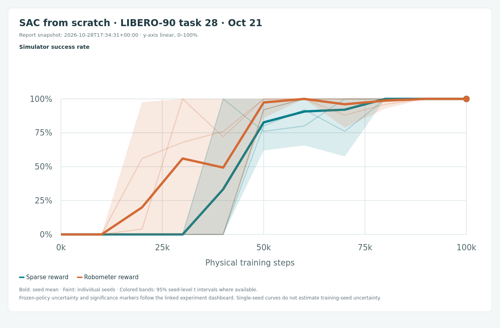
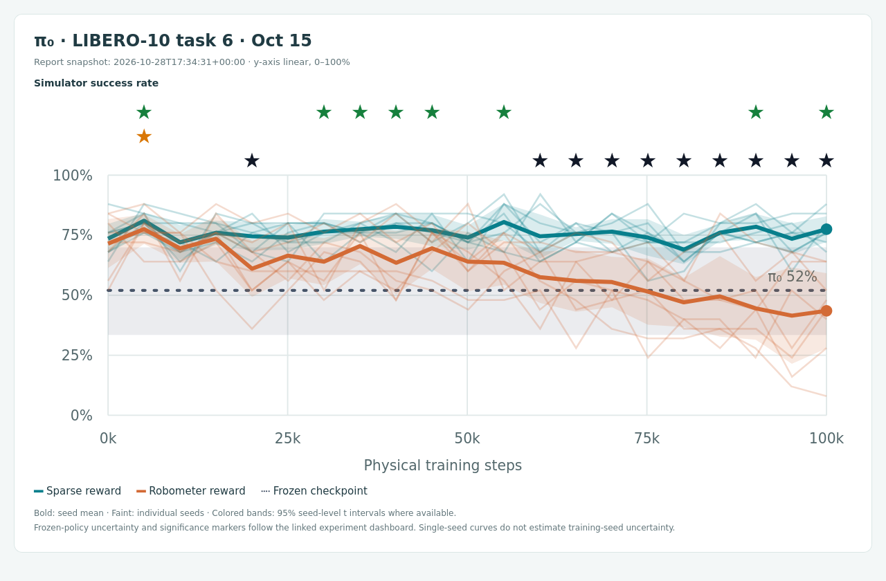
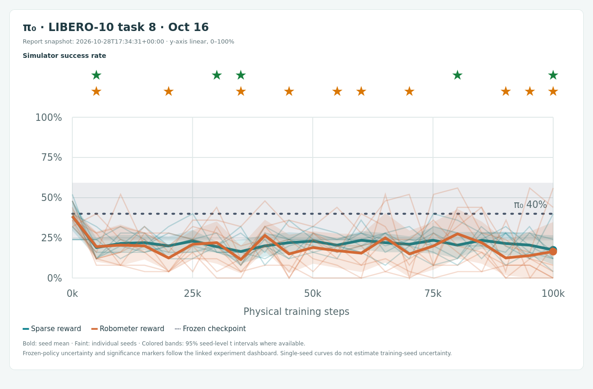
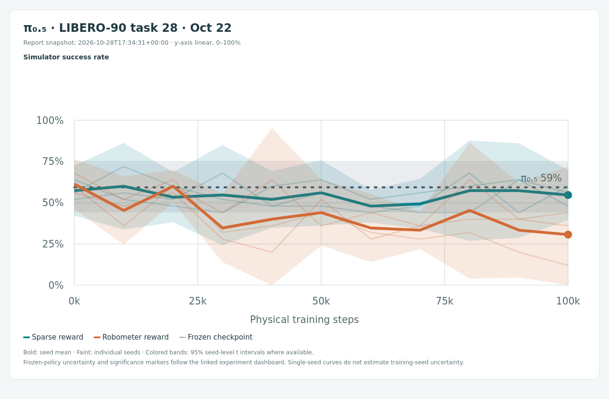
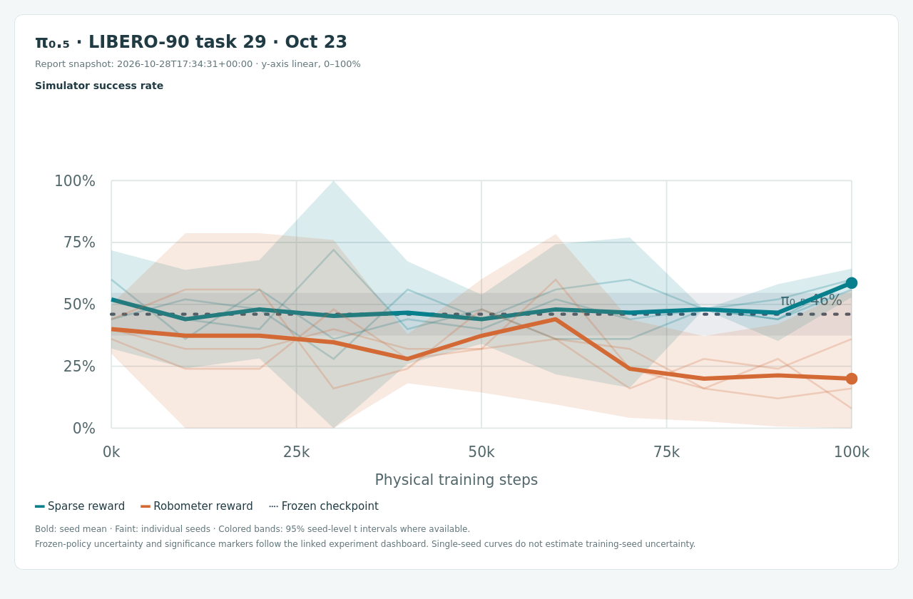
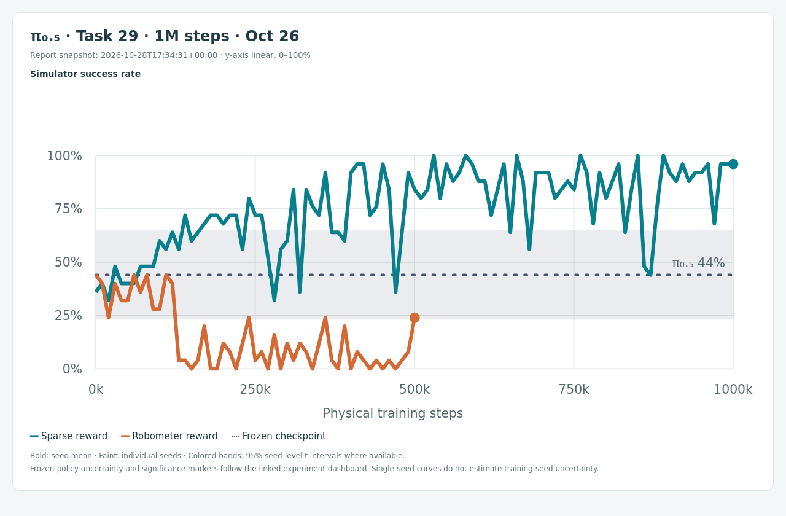
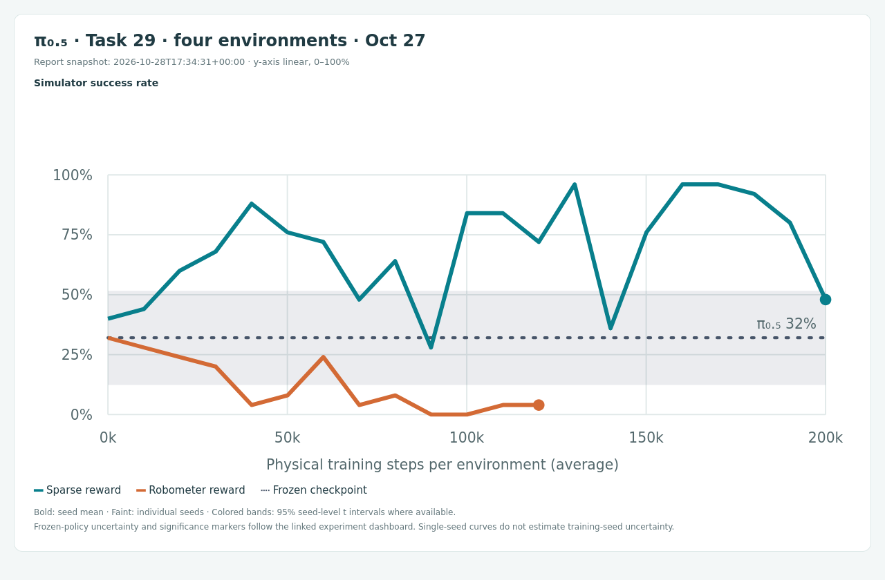
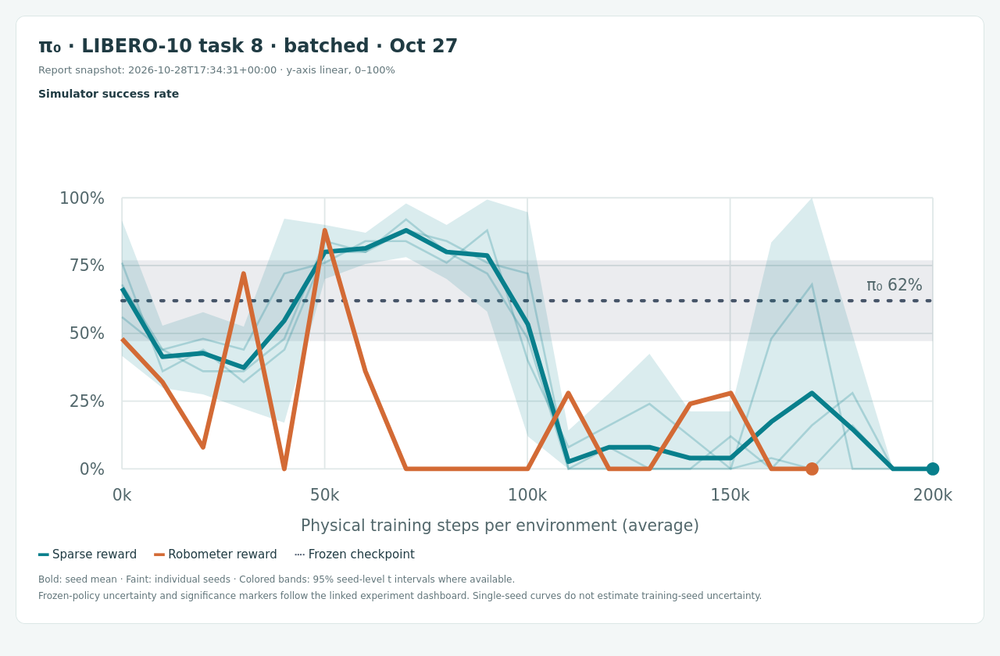

# Learned rewards for robot policy improvement

**Experiment summary · 2026-10-28** · Data read 2026-10-28T17:34:31+00:00 · A fixed snapshot of the local results; linked experiment pages continue updating. Task IDs are zero-based; experiment start dates below follow the dashboard's UTC dates.

**Question.** When does optimizing a pretrained robot policy with Robometer help, and when does it reduce simulator task success? These experiments motivate online reward-model correction, but **Robometer itself remains frozen** in the runs reported here. Our DSRL fine-tuning learns a noise-steering actor around frozen π₀ or π₀.₅ weights.

[Live experiment dashboard](http://172.28.5.161:8768/) · [Download Markdown](report.md) · [Download report with screenshots](http://172.28.5.161:8768/reports/reward_learning_summary_20261028/report_with_screenshots.zip) · [Numerical snapshot and run locations](evidence.json)

## 1. Sanity check: SAC from scratch

We first tested **LIBERO-90 task 28: close the top drawer**, using SAC with DINOv2-small visual features and either sparse simulator reward or Robometer reward. With **three seeds per variant**, both reached **100% final success at 100k physical steps**: 25/25 evaluation episodes in every seed. This establishes that the local pipeline can recover the high-success behavior motivating the paper's experiment. [Experiment and curves](http://172.28.5.161:8768/#sac-task28-general).

This is a **qualitative reproduction**, rather than an exact replication of every paper curve: we used three seeds instead of five, evaluated every 10k rather than 5k steps, and used the general `Robometer-4B` checkpoint rather than the LIBERO ablation models in the paper's Figure 5. Three seeds are reasonable for this sanity check, but provide weaker evidence about sample efficiency and seed variability. [Paper, Figure 5 and Appendix E.1](https://arxiv.org/html/2603.02115v2#A5.SS1).

Show SAC sanity-check curve

Report snapshot. Click a thumbnail to open its live experiment.

## 2. Fine-tuning pretrained policies: ID and held-out tasks

Here **in distribution (ID)** means inclusion of the task suite in the documented LIBERO checkpoint-training data. **OOD** means held-out LIBERO-90 tasks within the same simulator—not an entirely new visual domain. Public OpenPI training data include LIBERO-10/Object/Goal/Spatial; the pinned Robometer training provenance includes these suites and excludes LIBERO-90. Exact trajectory overlap and the foundation models' broader pretraining coverage are not established. [OpenPI dataset construction](https://github.com/Physical-Intelligence/openpi/blob/main/examples/libero/convert_libero_data_to_lerobot.py), [OpenPI task list](https://huggingface.co/datasets/physical-intelligence/libero/blob/main/meta/tasks.jsonl), [Robometer training split](https://arxiv.org/html/2603.02115v2#A1.SS1.SSS1.Px7).

| Experiment / start date | Policy checkpoint | Policy / reward coverage | Seeds per reward | Final sparse | Final Robometer | Final paired p |
|---|---|---|---:|---:|---:|---:|
| [LIBERO-10 task 6 · Oct 15](http://172.28.5.161:8768/#task-pi0_libero10_task06_dsrl_5seeds_20261015) | `pi0_libero` | ID / ID | 8 | **77.5%** | **43.5%** | **0.0078** |
| [LIBERO-10 task 8 · Oct 16](http://172.28.5.161:8768/#task-pi0_libero10_task08_dsrl_8seeds_20261016) | `pi0_libero` | ID / ID | 8 | 17.5% | 16.5% | 0.969 |
| [LIBERO-90 task 28 · Oct 22](http://172.28.5.161:8768/#task-pi05_libero90_task28_dsrl_3seeds_20261022) | `pi05_libero` | OOD / OOD | 3 | **54.7%** | **30.7%** | 0.25 |
| [LIBERO-90 task 29 · Oct 23](http://172.28.5.161:8768/#task-pi05_libero90_task29_task29_pi05_dsrl) | `pi05_libero` | OOD / OOD | 3 | **58.7%** | **20.0%** | 0.25 |

All four comparisons finish at **100k physical steps with one training environment**, use a 400-step horizon and 25 evaluation episodes per checkpoint, and evaluate deterministic latent actions. Final rates are means across seeds. The p-values are two-sided exact paired seed sign-flip tests, without multiplicity correction; only task 6 passes the nominal 0.05 threshold. Three pairs cannot produce a two-sided exact p below 0.25.

- **ID task 6**—white mug onto plate and pudding to its right—shows a 34-point Robometer deficit versus sparse reward (95% paired t interval: **14.6–53.4 points**). ID coverage does not guarantee a useful reward during optimization.
- **ID task 8**—both moka pots onto the stove—shows degradation relative to the frozen policy (the dashboard's independent frozen evaluation is 40%), but **not a meaningful final separation between rewards**. Sparse training also degrades. This is evidence of unstable policy improvement, not evidence of a Robometer-specific failure by itself.
- **OOD tasks 28/29** show lower Robometer final means. Task 29 asks for the black bowl in the top drawer. These are concerning observations, but the three-seed comparisons do not establish statistical significance or isolate reward error as the cause.

**Task 28 evaluation caveat.** A separate stochastic reevaluation of the same final checkpoints gave **57.3% sparse versus 49.3% Robometer**, an 8-point gap with paired p = 0.75. Thus evaluation convention explains part of the original 24-point gap. Reward formulation, optimizer settings, and the restriction to frozen-policy noise steering remain possible contributors. [Sampling controls, diagnostics, and videos](http://172.28.5.161:8768/video-audits/pi05_libero90_task28_seed100/diagnostics.html) · [Task 29 final-policy video audit](http://172.28.5.161:8768/video-audits/pi05_libero90_task29_final_seed100/).

**Checkpoints.** Policies are the released OpenPI `pi0_libero` and `pi05_libero` checkpoints, locally under `/data/rohan/Reward-Modeling/pi0_checkpoints/`. Every reward-model run above uses **`robometer/Robometer-4B@beef63bc914c5c189329d49c6d712d96d632aa34`**, not the separately released `Robometer-LIBERO`. Historical LIBERO-10 dotted baselines come from independent frozen evaluations; the π₀.₅ task 28/29 baselines pool run-level step-zero evaluations.

Show historical fine-tuning curves (4)

Report snapshot. Click a thumbnail to open its live experiment.

### DSRL implementation differences

The relevant reference for these frozen-π₀ experiments is the authors' **π₀/LIBERO implementation, `nakamotoo/dsrl_pi0`**, pinned to `7f48937d4553e95244cd81c79236a3256df80597`. Its LIBERO launch settings differ from our local DSRL configuration. The comparison below applies to **both our sparse and Robometer arms**; it does not describe differences caused solely by replacing the reward. The separate Robomimic Can experiment uses `ajwagen/dsrl`'s DSRL-NA variant and should not be used interchangeably as the π₀ update-schedule reference.

| Detail | Original π₀/LIBERO DSRL | Our reported π₀ / π₀.₅ DSRL runs |
|---|---|---|
| Updates per new replay chunk, after warm-up | **20 actor + 20 critic + 20 temperature updates** | **1 actor + 25 critic + 1 temperature update** |
| Collection / optimization schedule | Collect a complete episode, then run 20 joint updates per chunk in that episode | Collect a chunk from each active environment, then update once per collected chunk, with 25 critic updates inside each call |
| Warm-up threshold | Replay buffer must contain **more than 500 chunks**; checked at episode boundaries | `learning_starts=500` counts **total physical steps across environments**, checked before the next collection round |
| Approximate warm-up data | 500 × 20 actions ≈ **10,000 physical steps**, with episode-boundary overshoot | ≈ **25 π₀ chunks** or **50 π₀.₅ chunks** total, with collection-round overshoot; four environments do not each receive 500 warm-up steps |
| Batch / critic ensemble | Batch 256; 10 critics; mean Q reduction | Batch 128 per critic update; 5 critics; minimum Q reduction, sampling 2 critics for the backup |
| Chunk length / discount | 20 actions; discount `0.999^20` | π₀: 20 actions; π₀.₅: 10 actions; **both still use `0.999^20`** |
| Reward / evaluation | Sparse −1 until success, then 0; sampled latent policy during evaluation | Sparse 0/1 or mean Robometer progress per chunk; deterministic latent policy during the reported training evaluations |

Sources: [official LIBERO launch settings](https://github.com/nakamotoo/dsrl_pi0/blob/7f48937d4553e95244cd81c79236a3256df80597/examples/scripts/run_libero.sh), [collection, replay threshold, and evaluation](https://github.com/nakamotoo/dsrl_pi0/blob/7f48937d4553e95244cd81c79236a3256df80597/examples/train_utils_sim.py), [joint actor/critic/temperature update](https://github.com/nakamotoo/dsrl_pi0/blob/7f48937d4553e95244cd81c79236a3256df80597/jaxrl2/agents/pixel_sac/pixel_sac_learner.py). Local implementation: `experiments/libero/config.py`, `experiments/libero/train.py`, and `robometer_policy_learning/algorithms/sac/modeling_sac.py` in `robometer-policy-learning`. [Existing implementation audit and sampling controls](http://172.28.5.161:8768/video-audits/pi05_libero90_task28_seed100/diagnostics.html).

**Why this matters.** Per replay chunk, our actor receives **20× fewer updates**, while the critic receives 25 rather than 20; warm-up uses roughly **20× fewer chunks for π₀ and 10× fewer for π₀.₅**. These are materially different optimization settings. For example, a full four-environment π₀ collection round adds 80 physical steps (20 per environment), four replay chunks, and then **4 actor / 100 critic / 4 temperature updates**. Critic counts here mean ensemble optimizer steps, not individual network counts. The original launcher also counts its training/evaluation intervals in gradient updates, so its numeric “steps” cannot be compared directly with our physical-step axes.

Other possible contributors include our frozen DINO features versus the original learned image encoder, deterministic versus sampled evaluation (already consequential on task 28), and the stronger effective discount for ten-action π₀.₅ chunks: matching `0.999` per physical action would use `0.999^10 ≈ 0.9900`, instead of `0.9802`. Reward centering also changes incentives when success terminates an episode; positive progress can reward remaining in a partially completed state. These are hypotheses to test, not established explanations for the observed curves.

**Proposed controlled follow-up:** match 20 joint updates per replay chunk, count warm-up explicitly in replay chunks, and match chunk discount and evaluation convention before attributing all degradation to reward error. This documents differences in existing experiments; no training settings were changed for this report.

## 3. Longer training and parallel environments

Four environments provide a useful way to collect diverse experience concurrently. However, these runs change the data collection schedule and, for the new LIBERO-10 task 8 runs, the horizon from 400 to 600. They are not a controlled demonstration that parallelism improves learning efficiency.

| Follow-up | Evidence at this snapshot | Link |
|---|---|---|
| Task 29, π₀.₅, one environment, 1M steps | Sparse seed 100 finished at **96%**, first reaching 100% at approximately 530k steps. Robometer was stopped after its 500k evaluation (24%). | [Long run](http://172.28.5.161:8768/#task-pi05_libero90_task29_task29_pi05_dsrl_1m_20261026) |
| Task 29, π₀.₅, four environments, 200k steps/env | Sparse seed 100 peaked at **96% near 130k steps/env**, then finished at **48%**. Robometer was stopped after roughly 120k steps/env (4%). | [Parallel run](http://172.28.5.161:8768/#task-pi05_libero90_task29_task29_pi05_dsrl_4env_200k_20261027) |
| LIBERO-10 task 8, π₀, four environments, batched inference | Sparse seeds 100/101/102 peaked at **88–92% near 70k–90k steps/env**, but **all finished at 0% at 200k steps/env**. Robometer seed 100 peaked at 88% near 50k steps/env; its latest complete evaluation is 0% near 170k steps/env, with the run still ongoing. | [Parallel run and diagnostics](http://172.28.5.161:8768/#task-pi0_libero10_task08_libero10_task08_pi0_dsrl_batched_4env_200k_20261027) |

**Working hypothesis, not a finding:** extending training to **250k–300k physical steps per environment** could reveal later recovery, but the present curves do not justify calling improvement likely. The four-environment runs currently target only 200k steps/env; their early peaks followed by declines make stability and evaluation convention important follow-ups. More seeds and a controlled horizon-matched comparison are needed before attributing early progress to parallelism.

**Counting steps.** Main curves and diagnostic x-axes show average physical training steps per environment. Four environments × 200k steps/env = **800k total physical steps**. Each replay transition stores one action chunk: up to 20 executed actions for π₀, or 10 for π₀.₅. With four environments, one full collection round adds four replay transitions and advances the x-axis by 20 or 10 steps/env respectively. Early episode termination changes these approximate ratios. Raw logs retain total-step counts.

Show longer-training and parallel-env curves (3)

Report snapshot. Click a thumbnail to open its live experiment.

**Next evidence to collect:** compare sampled versus deterministic evaluation on saved checkpoints; inspect reward/progress against simulator success around the peaks and subsequent declines; then test longer horizons of training with matched seeds and clearly specified step units. These are proposed analyses, not newly launched experiments.
